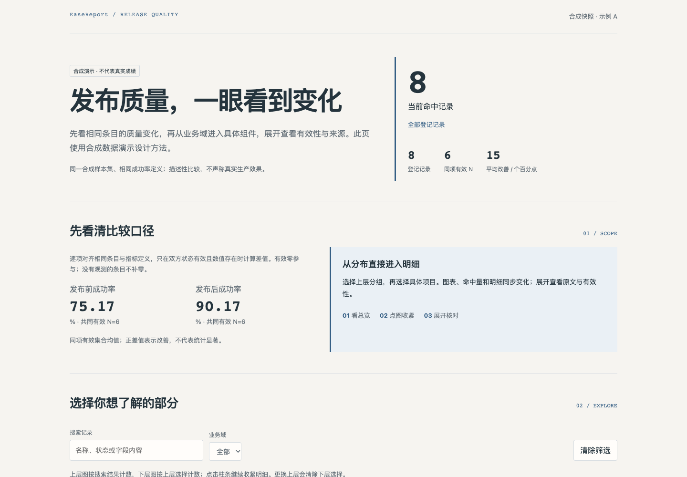
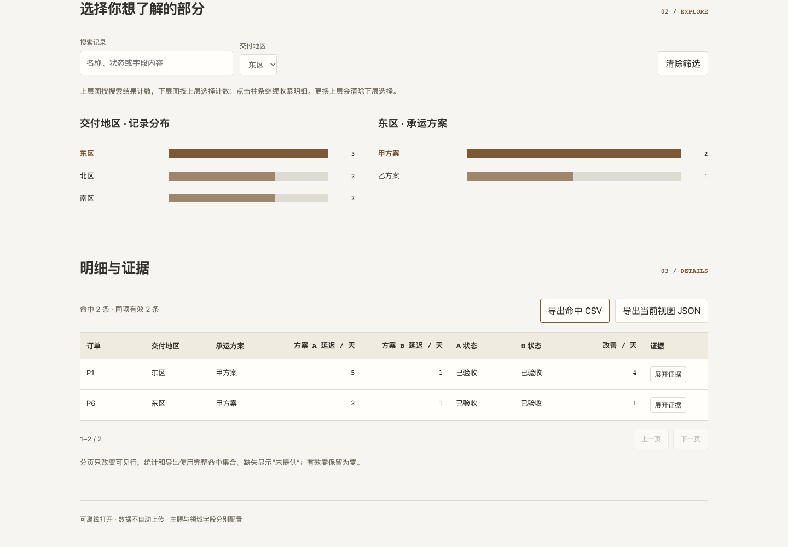

# EaseReport

**把复杂资料变成简洁直观、可以探索、能够核对的 HTML 报告。**

EaseReport 是一套跨领域的报告设计方法与 agent skill，覆盖数据语义、比较口径和交互状态设计，并提供可选的编辑式分析风格与可运行的离线示例。

从总览看清问题，点击图表收紧范围，再展开明细与证据。

[方法入口](SKILL.md) · [视觉与交互方案](references/editorial-analytical-style.md) · [迭代与验证](references/evolution-and-validation.md) · [更新记录](CHANGELOG.md)

## 先看效果

### 发布质量：总览清楚，再进入组件



[示例 HTML](demos/release-quality.html) · [合成数据与配置](examples/release-quality.json)

### 供应商交付：点地区，再点方案，明细同步收紧



[示例 HTML](demos/supplier-delivery.html) · [合成数据与配置](examples/supplier-delivery.json)

GitHub 文件页不会直接运行 HTML。下载 HTML（Download raw file）后用浏览器打开即可，数据与样式均已内嵌。两份示例都是合成演示，不代表真实业务成绩。

## 方法包含什么

| 核心 | 如何落实 |
|---|---|
| 先明确要判断什么 | 从用户问法、数据粒度、对齐条件和证据出发，再选择页面结构。 |
| 比较有依据 | 同项与非同项分开；单位、好坏方向、有效分母、缺失和重跑策略可解释。 |
| 交互语义稳定 | 独立管理可见对象、比较范围、样本条件和聚合策略。隐藏对象不悄悄改变基线。 |
| 简洁而有深度 | 每节回答一个问题；用少数高价值动作进入更细的证据，复杂条件按需展开。 |
| 图表可以直接操作 | 上层分组 → 下层项目 → 对应明细；选中态、结果数和清除入口保持可见。 |
| 数字和导出一致 | 图表、摘要、表格和导出复用同一分析状态；分页不截断统计。 |
| 跨领域适配 | 字段、对象、单位、状态、主题、数据来源与技术栈分别配置。 |
| 持续可迭代 | 从真实反馈做有边界的改进，明确不变量，检查兼容性并跨领域回归。 |

## 如何使用

### 作为 skill 使用

将本仓库作为名为 `ease-report` 的 skill 目录，按所用 agent 工具的安装方式加载根目录的 [SKILL.md](SKILL.md)。在请求中调用 `$ease-report`，并给出资料、数据路径、已有报告或目标判断。

例如：

> 使用 $ease-report 改进这份已有报告。保留数据与统计口径，让读者先看清结论，再通过图表筛选到个案和证据。优先简洁直观，沿用现有技术栈。

或者：

> 使用 $ease-report 比较这些供应商在同批订单上的交付表现。延迟越低越好；失败与缺失不补成零。采用编辑式分析风格，颜色沿用我们的品牌，并交付单文件离线 HTML。

方法层支持任意对象数量和合适的交付方式。已有报告可只做局部改进；单文件、资产包或服务型应用按数据体量和权限选择。

### 直接运行离线参考示例

只需要 **Python 3.10+ 标准库**，无需安装目标领域依赖或启动服务：

```sh
python scripts/build_editorial_example.py \
  --data examples/release-quality.json \
  --out generated/release-quality.html

python scripts/build_editorial_example.py \
  --data examples/supplier-delivery.json \
  --out generated/supplier-delivery.html
```

示例配置声明字段映射、分类维度、配对条件、指标方向、单位与语义颜色。生成后直接在浏览器打开。

[示例适配契约](references/editorial-example-contract.md)解释了各字段。参考骨架演示固定一对对象、一至两个分类维度、一个可选配对指标；复杂分析继续按通用方法设计，保留适合的框架和数据模型。

## 视觉方案如何泛化

编辑式分析方案迁移的是 **信息层级、阅读节奏、留白、稳定对齐和操作关系**：

- 首屏一个核心发现或问题，关键数字从属且有口径；没有可靠 KPI 时用摘要。
- 用章节、细分隔线和适当行宽组织长页；卡片用于同级对象或独立证据。
- 图表承担分组、选择或定位动作；点击后给出清楚的范围反馈。
- 明细原位展开，保留原始值、有效性与来源；概览保持紧凑。
- 主题由语义 tokens 控制，字体、宽度和密度可映射到现有设计系统；颜色不与领域绑定。

此方案是可选设计方向。用户已有视觉系统、不同报告任务或其他合适结构时继续沿用；不固定章节数量、图表类型、列名、评分公式、品牌或技术栈。

## 保持可迭代

维护循环：

**真实反馈 → 定位原因 → 最小修改 → 明确不变量 → 原场景与另一领域验证 → 记录结果。**

1. 来源适配、统计语义、分析策略、交互状态、视觉主题、导出保持职责边界。
2. 视觉优化保持筛选集合与统计含义；新的缺失惩罚或默认策略单独命名并说明。
3. 示例配置使用 `exampleSchemaVersion`，视图导出使用 `viewSchemaVersion`。不支持的输入版本明确拒绝；格式变化需要说明兼容或迁移处理。
4. 两个领域回归检查不同单位、方向、状态和证据，防止领域特例固化。
5. 保留已验证能力，按风险决定验证范围。可迭代不等于自动监控、自行扩权或自动发布。

目前视图 JSON 用于导出追查，**没有实现导入恢复**；复杂补值、加权、多对象选择和高级条件属于通用设计方法，未在小型参考骨架里实现。实际能力与后续建议分开记录。

## 验证

```sh
python -m unittest discover -s tests -v
```

构建器有 14 个测试，覆盖契约、两份领域配置、零/缺失保留、版本拒绝、数据安全序列化和可选模块。浏览器验收检查两级图表联动、配对有效分母、高/低指标方向、分页、证据、导出及窄屏。详见 [验收记录](docs/verification.json)。

可选浏览器走查需要本机已有 Node.js、Playwright 与 Chrome；它们不是生成或打开报告的运行时依赖：

```sh
python tests/prepare_browser_fixtures.py --out /tmp/easereport-qa
node tests/browser_smoke.mjs /tmp/easereport-qa
```

示例不是新的评测实验；验证不会重跑生产任务，也不会自动上传数据。

## 目录

```text
SKILL.md        方法入口与按需路由
references/     数据/比较、交互/呈现、视觉方案、迭代与适配契约
assets/         可选 CSS 原语与小型 HTML 交互骨架
scripts/        标准库单文件示例构建器
examples/       两份跨领域合成配置
demos/          可下载离线示例
tests/          构建与浏览器回归
docs/           实际截图及本次验收记录
```

## 许可证

本项目采用 [MIT License](LICENSE)。版权署名：YijunShen05。
